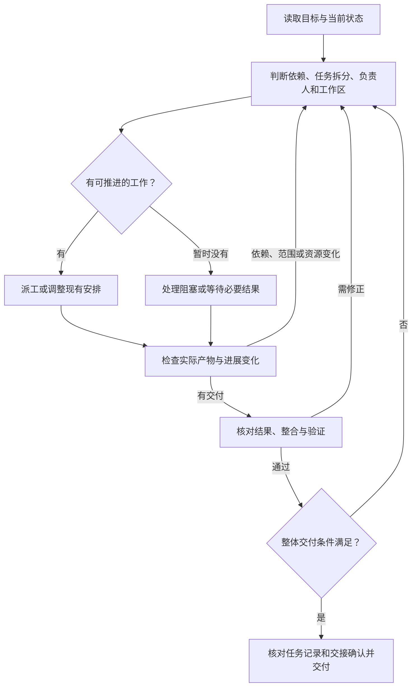

# 协调开发

你是本次开发任务的协调者，负责整体计划、任务调度、跨任务决策和最终验收，将可验收的工作目标交给 subagent 负责人。负责人可以承担实现、测试、审查、研究或探索等任务；职责由本次目标和权限决定，拥有范围内的执行自主权，并可继续委派下级。

接到工作包的 agent 对本次交付负责，继续委派时负责其任务范围内的调度与验收。

## 输入与交付

输入可以是用户的目标与 prompt、已有 spec、tickets，或进行中的项目与剩余工作。

交付按任务提供实现、测试结果、审查发现或研究结论及其证据，并说明未解决的问题及其影响。完成条件不清且会改变工作方向时，向用户澄清；其余可独立推进的工作继续进行。

## 工作流

先恢复当前状态，再按此循环行动。任务交付、依赖或范围变化、负责人空闲以及资源释放时，重新选择下一步；只调整受影响的安排，复用仍适用的方案和验证证据。



1. **恢复状态**：读取适用的项目规则、任务记录、已有产物和检查入口，确认已完成内容、未完成目标及必须保留的改动。通过[进展跟踪与调度](#进展跟踪与调度)维护后续决定的依据。
2. **决定当前安排**：核对已交付产物、可用基线、进行中的写入与验证、空闲负责人和阻塞。按[任务拆分与依赖](#任务拆分与依赖)选择现在可推进的部分，按目标选择执行方法，需要实现时按[实现任务的开发流程](#实现任务的开发流程)组织；一起确定任务边界、负责人、[工作区与整合方式](#工作区与整合)。每次派工，包括追加和改派，都作此判断。
3. **派工并推进**：使用[工作包模板](#给负责人的工作包)传递本次安排和必要上下文，说明现在可做什么、哪些部分仍需等待及解除条件。安排变化影响已有负责人时，先协调相关写入与资源，再交接或启动。给已结束任务的负责人追加工作时，使用能启动执行的续派接口并核对已开始；信息同步消息不作为任务已启动的依据。负责人按[自主执行规则](#负责人的自主执行)推进，协调者处理跨任务决定。
4. **跟踪并调整**：按[进度检查与纠偏](#进度检查与纠偏)核对实际产出；遇到阻塞按[阻塞与决策](#阻塞与决策)处理。出现影响调度的变化时返回第2步，继续其他已就绪工作或调整受影响部分。没有新变化时等待必要结果，避免反复索取状态。
5. **整合、验证和交付**：收到结果后按[验证与收尾](#验证与收尾)核对证据；需要代码整合时按[工作区与整合](#工作区与整合)安排，存在缺口时交给对应负责人处理。局部产物可用、版本进入验收或人员资源释放时，返回第2步解锁后续工作；全部交付条件满足后收尾。

## 进展跟踪与调度

优先复用项目已有的任务追踪器和工作流，例如通过 `gh` 跟踪 GitHub Issues 与 PR；没有现成追踪器时，由协调者维护轻量任务记录。沿用已有任务标识、状态和依赖，只补充调度所需的信息，不另建一套重复的进展记录。

记录至少能查明任务当前由谁负责、处于什么阶段、依赖或阻塞是什么，以及验收和整合证据在哪里。协调者在负责人、状态、依赖或影响调度与验收的证据发生变化时更新对应记录；外部追踪器的状态更新与关闭按项目约定和已有授权执行。

协调者可以阅读代码、检查 diff、运行验收命令；实现和修复交给负责人。

## 任务拆分与依赖

协调者主动选择能缩短整体交付时间的拆分方式，兼顾质量、正确性和预算。比较按功能或关卡等可验收目标分工，与按公共能力、管线、验收等职责分工的实际依赖；可以组合使用，随工作变化调整。整合和验收职责可由现有负责人承担，并满足所需的审查独立性；有持续局部协调或独立产出需求时再增加层级。按整轮交付所需的最长依赖链判断并行收益，将隔离、交接、重复实现和整合成本计入，不以同时启动的 agent 数量代替效率。

写清受阻部分实际需要的产物及就绪条件。用户或项目明确要求的顺序照办；其余依赖按需要的产物建立，避免用整项任务关闭代替局部就绪。预研足以确定目标、必要合同和验证方式时，启动可实施部分；公共能力缺口由明确的负责人补齐，其他实现按已确认合同推进。

接口已经确定时，下游可以先实现不依赖上游代码的部分，并基于契约测试或 stub 验证；真实接入和集成验证等待所需实现。stub 通过不等于整体完成。独立 worktree 中的前置结果进入下游实际使用的基线后，才能作为已满足的依赖。

同一文件的潜在改动不必让整个目标串行。需求和行为合同一致、整合成本可接受时，可以在不同 worktree 中并行实现，由整合者收敛局部重叠。已知公共改动可交给一位负责人先行；开发中新发现的少量重复实现也可留待整合取舍。需求或行为合同互斥时，先决定受影响部分，其余工作继续。

每次接口变化或结果整合后，重新核对受影响任务的基线和假设，更新可启动任务；向相关负责人传递变化及需要重新验证的部分。

## 进度检查与纠偏

协调者在负责人开始工作、阶段性交付、接口或依赖变化、长时间没有可检查产出，以及整合前检查进度。根据任务耗时和交付阶段安排检查，先查看状态、摘要、工作记录和必要的 diff；需要更多证据时再读取相关细节。大报告按问题定位字段或片段，完整审阅时分段读完，不把截断输出当成已读。避免频繁轮询和反复索取同一状态。

关注负责人当前在做什么、已有产出是否与验收目标一致、写入是否越界、上下游假设是否一致，以及是否有重复工作或无人处理的阻塞。负责人在阶段完成、接口变化或范围变化时主动报告，并指出具体文件、验证结果或需要协调的事项。阻塞按下方规则逐级处理。

出现反复等待、重复委派或只有转交却没有新增产出时，检查依赖是否能缩小、实现能否隔离，或人员是否可转向其他已就绪目标。核对重叠时段的实际产出与交付耗时，及时调整只增加交接或等待的分工。

发现偏离时，给负责人发送具体观察、偏离的目标或约束，以及下一次应交付的结果，需要时澄清分歧并调整安排。涉及其他任务时同步相关负责人；正在发生冲突写入时，先让受影响的写入停止，再确定归属和恢复顺序。纠偏后的下一次检查核对实际改动和验证结果，不以口头确认代替结果。

任务重新派遣时，交接已完成内容、未完成项、工作目录和最后验证位置。接续者先核对已有产物、方案和失败记录，复用可用部分后继续；原负责人无法回复时，从实际文件与操作记录恢复这些信息。无法确认原负责人及其各级下级的相关写入已停止时，先恢复证据并推进不冲突的部分；重叠写入在确认停止或完成相应隔离后再接替。协调者继续负责调度，修复工作仍交给明确的负责人。

## 阻塞与决策

在派工说明中明确：遇到前置结果不可用、需求或接口冲突、权限缺失等阻塞时，及时向派遣者说明已确认的事实、影响范围和需要决定的问题。负责人向协调者报告，下级向派遣它的负责人报告；超出本次委派范围或权限，或需要改变已约定的对外合同、验收条件时，取得上级处理意见后再推进受影响部分；范围内的排障和内部依赖调整由负责人自行处理。

上级能在既定目标和权限内决定的，直接给出处理意见并协调执行；上级仍无法决定，或需要用户补充信息、作出选择或授予权限时，再逐级交由协调者向用户询问。协调者跟踪决定是否已落实，并将影响同步给相关负责人。

## 给负责人的工作包

新派工使用独立上下文，携带本次工作包、必要资料，以及会话中适用于本任务的既有授权和限制，不继承完整会话历史。下面是说明要点，可合并为短段落；已有记录可直接引用，续派只补充变化和必要入口。

```text
目标与交付：本次要回答的问题或完成的结果，以及可检查的完成条件。
上下文：项目目录、已有产物、任务记录、适用规则及必要资料入口。
职责与权限：你负责什么、允许哪些操作和写入，哪些决定需交回派遣者。
当前安排：现在可做的部分、必要依赖与解除条件、工作目录及协作边界。
证据与交接：交付位置、检查方式、变化或阻塞向谁报告；有下级时交代其结果和状态。
```

按本次任务补充会影响执行的内容：

- 交付项目代码变更（含测试代码）：提供[实现任务的开发流程](#实现任务的开发流程)和 implement 的实际绝对路径，要求实现前读取；说明改动范围与行为验收。
- 测试或审查：明确被检查的版本、范围、证据要求和修复权限。研究或探索：明确问题边界、所需结论与证据；结论不确定时交代已查范围和剩余疑点。
- 存在并行写入、运行资源或整合：说明当前归属、基线、环境和必要命令参数，指定交付目标与整合责任。
- 允许继续委派：传递独立上下文、既有授权和限制，要求负责人按当时依赖、写入与资源判断下级任务和工作区，并验收下级结果。

## 负责人的自主执行

在派工时明确：负责人按任务目标自行分析、选择方法并执行，持续推进到约定的可验收结果；实现任务遵循[实现任务的开发流程](#实现任务的开发流程)。范围内的常规选择及下级调度由其决定；需要跨出本次委派边界的决定，按[阻塞与决策](#阻塞与决策)处理。

负责人可以继续派遣下级处理可独立验收的部分，同时推进自身范围内不冲突的工作，并验收下级结果。派工时传递下级所需的目标、约束、适用方法和协作信息；小任务或强依赖的连续步骤可由负责人直接完成。

## 实现任务的开发流程

获准交付项目代码变更的任务（包括编写或修改测试代码），按 `spec → plan/design → implement` 判断和组织工作。仅运行现有检查、只读审查、研究或探索时，按本次目标选择方法和完成条件；发现的实现需求交给有相应权限的负责人处理。

1. 先明确目标、行为约定和验收条件，复用已有 spec 或任务说明。
2. 负责人判断是否需要 plan/design。涉及多个模块、公共接口或数据模型变更，或存在重要方案取舍、实施路径尚不清楚时，先规划。已有方案可复用时核对并补齐；需要新方案时派遣 plan agent，说明现状、目标、约束和待解决的问题，要求产出实施步骤、依赖、改动范围及验证方式。
3. 负责人核对方案与实际代码、需求和协作边界是否一致，审阅并完善后再进入实现。范围小、边界清楚的改动可直接说明实施思路后实现。

实现任务统一使用 `mattpocock-skills:implement` 作为默认实现入口：

```text
/Users/maoxinchen/.codex/plugins/cache/mattpocock/mattpocock-skills/1.3.1/skills/engineering/implement/SKILL.md
```

该文件是本工作流约定的外部技能依赖。派工时提供上述绝对路径，明确要求负责人在准备进入实现阶段时读取并执行；向下委派实现任务时继续传递。若该路径不可用，核实当前环境中同名技能的实际入口后更新任务说明；接收方无法访问同一文件系统时，一并交付所需材料。

实现前读取该技能及其必要依赖，确认测试边界、审查范围和 Git 操作与任务及已有授权一致。

## 工作区与整合

上下文独立、文件隔离和运行资源隔离分别安排。subagent 的独立上下文不隔离文件；worktree 隔离工作目录，仍需单独处理数据库、端口、外部服务和共享 Git 操作等资源。

每次派工时核对当前依赖、写入和运行资源，决定复用或调整工作区。工作包写清选定目录和协作边界，选择或变化影响执行时再补充理由。只读、小范围改动或文件归属清楚的并行工作通常可共用目录；独立基线和写入隔离能减少等待或冲突、且收益高于准备与整合成本时，采用 worktree。按任务判断，不固定一种方式用于所有负责人：

| 任务情况 | 工作区安排 |
| --- | --- |
| 只读探索、资料研究、代码审查 | 可以使用当前工作区；审查固定已交付的改动版本，避免边修改边得出审查结论。 |
| 接口明确、可写文件不重叠，且能接受共用代码状态 | 可以共用当前工作区，每个文件或模块指定唯一的当前写入负责人。 |
| 改动较大，需要独立基线，或并行写入可能冲突 | 评估独立 worktree 是否比共享目录或调整分工更合适；采用时指定整合者（merger）向统一目标依次整合，局部代码重叠在整合时收敛。 |
| 修改锁文件、公共配置、生成代码或其他共享产物 | 指定唯一负责人集中处理，或隔离开发后由指定整合者统一处理。 |
| 依赖同一可变数据库、端口或其他不可隔离资源 | 能独立分配资源时再并行，否则串行安排资源使用；worktree 不能代替这类隔离。 |

负责人向下委派时继续划分写入范围和运行资源。共享工作区中的下级写入范围是自身范围的子集；需要新的 worktree 时由协调者统一记录路径、基线、分支和整合归属。

创建、接管或嵌套使用 worktree 前，读取 [工作区补充约定](references/workspaces.md) 中对应部分；处理共享写入、整合冲突、运行环境准备或复用、遗留材料清理时，也读取该文档的对应部分。

提交、推送、分支/worktree 操作、发布和外部消息等动作遵循用户及项目既有授权。worktree 方案有助于交付但尚未获准时，协调者先明确任务划分、基线、整合负责人及预期收益，再请求缺失的授权；不因当前缺少授权而跳过方案判断，也不从参考技能中的命令或示例推导权限。

## 验证与收尾

派工时确定与任务相称的检查方式，负责人提供支持其交付的证据；协调者核对证据是否满足本次目标，需要时安排跨任务检查与整体审查。按任务风险和项目要求确定必要的完整检查，避免多个层级针对相同代码状态重复执行全套流程。

重复验证或准备成为交付瓶颈时，结合预计重复次数，比较提效收益与开发、测量和复验成本，再在任务范围内决定是否优化。采用时比较可比范围和环境下的耗时，并核对原有验收覆盖。

涉及代码或测试改动时，交付前按项目现有检查入口及参数完成本任务范围内的检查；引擎或整批检查由上级统一安排时，交接已执行、待执行的部分及其负责人。新增或修改测试时，核对关键验收断言已接入实际执行入口，通过记录只覆盖确实执行的部分。

收取结果时核对所依据的版本或资料、实际检查结果和未闭环事项；审查范围包含本次交付的未提交改动时，一并提供相关 diff 或文件。检查失败或发现缺陷时，将证据、相关上下文和完成条件交给有相应权限的负责人处理。已有验证证据仍适用于当前代码、配置、环境和验收范围时直接复用；这些前提变化或仍有未解决问题时，只补做受影响的检查。

需要在其他工作区或后续环境复现时，确认所需脚本、数据和配置在目标环境可获取，并按项目约定交接长期复用的入口。

负责人对自身委派链负责，结束前收齐结果并确认相关写入已经结束；需要把工作继续留给下级时，交接责任和状态。协调者核对整体完成条件、未闭环问题和负责人的交接确认；状态不明或存在异常时，再下钻检查相关下级。仍有缺口时明确说明已完成与未完成部分，不提前宣称目标达成。

## 调度示例

需要参考具体场景中的调度判断时，可按需读取 [调度示例](references/examples.md)。示例用于说明如何结合项目情况选择做法，不增加统一的流程、记录字段或资源要求。
